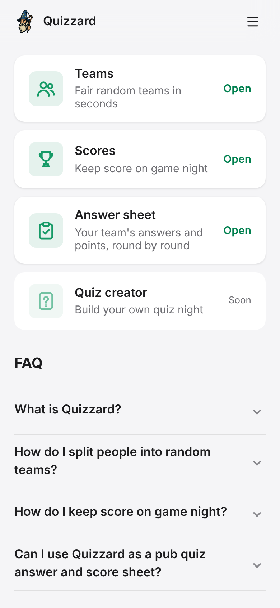
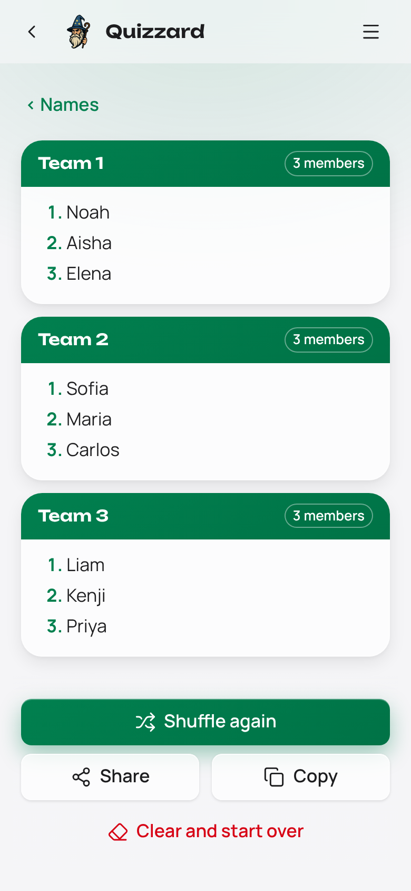
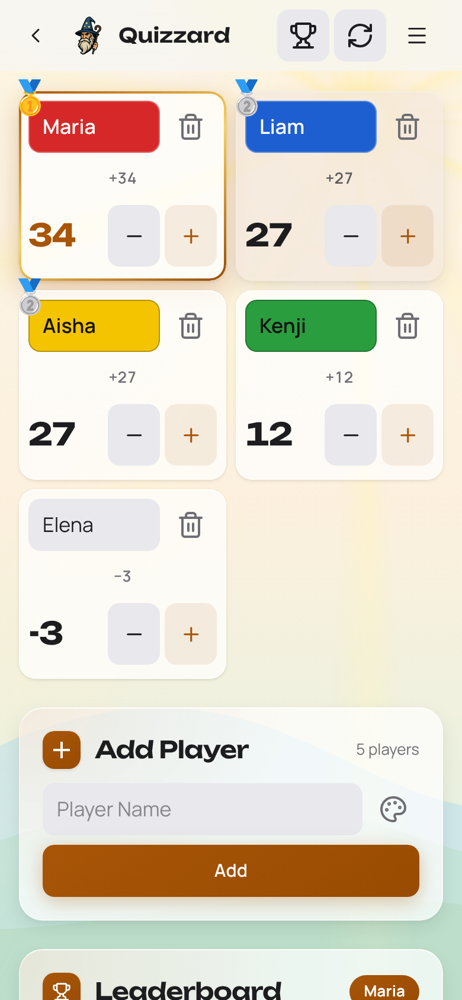
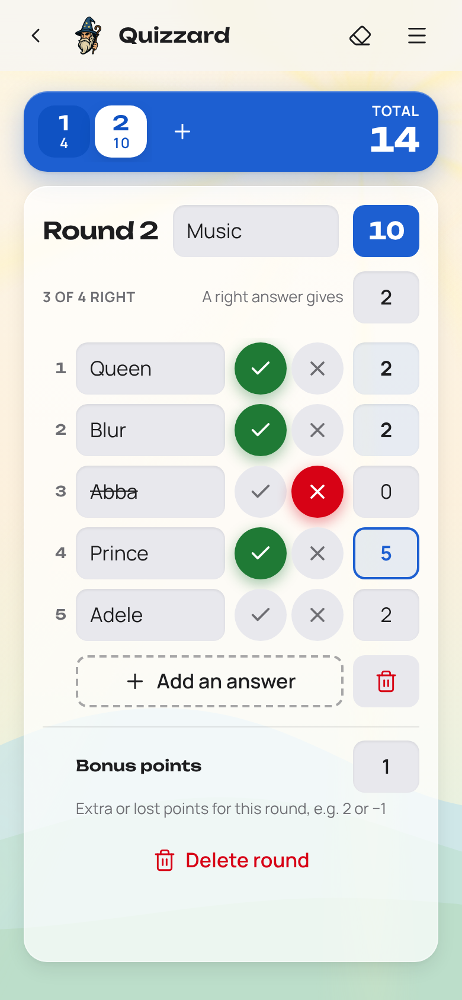
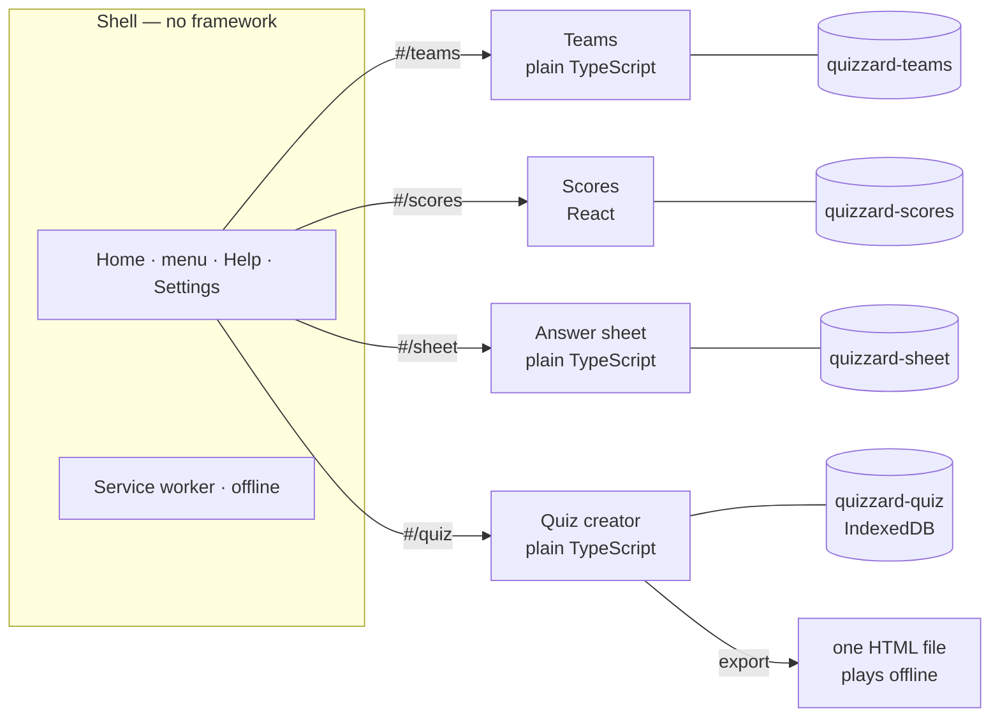

<div align="center">


# Quizzard

### The Quiz Toolkit

Free tools for pub quizzes and game nights — a **quiz maker** that plays on a big screen, **random teams**, a **score keeper** and a **team answer sheet**.<br />
Works offline, needs no account, and everything you enter stays on your device.

<p>
  <a href="https://simeontsvetanov.github.io/Quizzard/"></a>
</p>

<p>
  <a href="https://github.com/SimeonTsvetanov/Quizzard/actions/workflows/ci.yml"></a>
  <a href="CHANGELOG.md"></a>
  <a href="LICENSE"></a>
  
  
  
</p>

<a href="https://simeontsvetanov.github.io/Quizzard/">App</a> ·
<a href="docs/index.md">User guide</a> ·
<a href="CHANGELOG.md">What changed</a> ·
<a href="https://github.com/SimeonTsvetanov/Quizzard/issues/new">Report a problem</a>

<br /><br />

<picture>
  <source media="(prefers-color-scheme: dark)" srcset="docs/images/home-dark.png" />
  
</picture>

</div>

## What is in the toolkit

<table>
<tr>
<td width="33%" valign="top" align="center">

<picture>
  <source media="(prefers-color-scheme: dark)" srcset="docs/images/teams-result-dark.png" />
  
</picture>

### Teams

Paste the names, pick how many teams, tap once. Every split is equally likely and team sizes differ by at most one. Copy or share the result to any chat.

</td>
<td width="33%" valign="top" align="center">

<picture>
  <source media="(prefers-color-scheme: dark)" srcset="docs/images/scores-game-dark.png" />
  
</picture>

### Scores

Keep score for any game: add players, tap + or −, or add any amount. A leaderboard with medals, a history of every change, a colour for each player's name, and a shareable result.

</td>
<td width="33%" valign="top" align="center">

<picture>
  <source media="(prefers-color-scheme: dark)" srcset="docs/images/answer-sheet-dark.png" />
  
</picture>

### Answer sheet

Your team's sheet at a pub quiz, instead of paper. Write the answers of each round, tap ✓ or ✗ when they are read out, and see the round and the total at once.

</td>
</tr>
</table>

### Quiz creator

Build your own quiz night and run it from the same app.

- **Make it:** rounds and questions with open, multiple-choice or true/false answers; pictures, audio and video; cut and shrink a clip on the device while you add it; a picture or a clip shown with the answer; music under the questions — one song each, or a whole folder handed out over the quiz; time and points per round or per question; a live preview of every slide. The questions stay blurred until you ask to see them.
- **Round kinds:** *Standard*, *Golden pyramid* (4 questions that ask for 1, 2, 3 and 4 answers — 10 points), *Safe* (5 one-digit answers that open a vault, with a bonus for the full code), *Make the quizmaster laugh* (one ready-made screen: every team tells a joke; the two funniest score) and *Free game* (your own task — draw, build, sing — with a timer and points).
- **Play it:** a stage for the big screen with a timer, the answers of each round — one by one or all at once, as the round is set — points entry, standings and a break with music; questions that follow by themselves, clips that start with their timer; an audience window with a host panel beside it (timer, break, scores, your notes); the stage in English or Bulgarian, whatever the quiz's language.
- **Take it with you:** export the quiz as one HTML file that plays offline in any browser, or save it as a quiz file to move it to another device.

## Why people use it

| | |
|---|---|
| **Free** | No price, no ads, no "pro" tier. Open source under MIT. |
| **Private** | No account, no tracking, no cookies. What you type never leaves the browser unless you share it yourself. |
| **Offline** | After the first visit it works without a connection — also in a basement pub. |
| **An app, not a web page** | Install it on Android, iPhone or a computer; each tool is one screen made for a phone held in one hand. |
| **Two languages** | English and Bulgarian, switched in Settings. |
| **Light and dark** | Follows the device, or pick one. |

## Use it

<!-- forge:usage:start -->
- **Browser:** https://simeontsvetanov.github.io/Quizzard/
- **For AI agents:** [llms.txt](https://simeontsvetanov.github.io/Quizzard/llms.txt) · [llms-full.txt](https://simeontsvetanov.github.io/Quizzard/llms-full.txt)
<!-- forge:usage:end -->

**Install it as an app**

- **Android / Chrome / Edge:** open the menu and choose **Install app**.
- **iPhone / iPad:** tap Share, then **Add to Home Screen**.
- **Computer:** use the install icon in the address bar.

Long-press the installed icon to jump straight to Teams, Scores, Answer sheet or Quiz creator.

## Guide

The user guide lives in [`docs/`](docs/index.md) and is mirrored to the repository's Wiki on every release.

- [Make random teams](docs/how-to/make-teams.md)
- [Keep score](docs/how-to/keep-score.md)
- [Use the answer sheet](docs/how-to/use-the-answer-sheet.md)
- [Make a quiz](docs/how-to/make-a-quiz.md)
- [Play a quiz](docs/how-to/play-a-quiz.md)
- [Install the app](docs/how-to/install-the-app.md)
- [Change the language and theme](docs/how-to/change-language-and-theme.md)
- [Back up and move your data](docs/how-to/back-up-and-move-your-data.md)
- [Settings](docs/reference/settings.md) · [Limits](docs/reference/limits.md) · [Privacy and your data](docs/about/privacy-and-data.md)

## How it is built

One installable web app (the *shell*) that hosts small tools (*mini-apps*) behind a tiny contract: each tool exports `mount(element, context)` and gets the shell's language, theme, messages, sharing and its own storage area. A tool's code is downloaded only when it is opened, then kept for offline use.



- **TypeScript, strict.** Vite, pnpm workspace, no backend, hosted on GitHub Pages.
- **Each tool owns its data.** Separate storage areas in the browser; Settings shows, exports, imports and clears them per tool.
- **Tested where it matters.** Unit and property tests for the logic on every push, and browser tests of every flow on Chromium, Firefox and WebKit, desktop and phone sizes, on pull requests and on demand.
- **Accessible by default.** WCAG 2.2 AA checks run in the browser tests; 44 px touch targets; keyboard and screen-reader paths.
- **Strict Content Security Policy,** pinned GitHub Actions, CodeQL, and a supply-chain policy for dependencies.

```
app/              the shell: Home, menu, dialogs, router, service worker
packages/core/    the mini-app contract, registry and route parser (pure logic)
miniapps/teams/   Teams        miniapps/scores/   Scores        miniapps/sheet/   Answer sheet
miniapps/quiz/    Quiz creator: core (model, round and question kinds), player (the stage, also the exported file), miniapp (editor)
content/legal/    Terms, Privacy and the other policy texts
docs/             user guide (mirrored to the Wiki) + SPEC, PLAN, DECISIONS
tests/e2e/        browser tests of the shell and of each tool
```

More detail: [ARCHITECTURE](docs/ARCHITECTURE.md) · [SPEC](docs/SPEC.md) · [DECISIONS](docs/DECISIONS.md).

## Development

```bash
pnpm install
pnpm dev        # http://localhost:5173/Quizzard/
pnpm verify     # generate + lint + typecheck + unit tests + docs check + build + size budgets
pnpm e2e        # browser tests against the production build
```

Node 24 and pnpm (via Corepack). Contributor notes for people and coding agents are in [AGENTS.md](AGENTS.md).

## Privacy

Runs in your browser — what you enter never leaves your device. No accounts, no tracking, no cookies.
Details: [Privacy](https://simeontsvetanov.github.io/Quizzard/privacy/) · [Security policy](SECURITY.md).

## Support

Free and open source. If it helped your quiz night, you can [buy me a coffee ☕](https://buymeacoffee.com/simeontsvetanov).

## Licence

MIT — see [LICENSE](LICENSE). Made by [Simeon Tsvetanov](https://github.com/SimeonTsvetanov) in Bulgaria.
