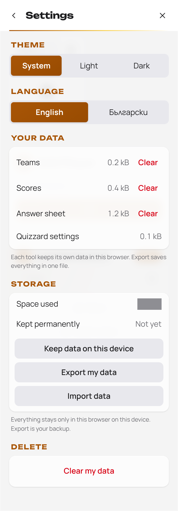

# Back up and move your data

This guide shows you how to save everything Quizzard keeps to one file, load that file on this or another device, delete the data of one tool, and delete all of it.

Quizzard saves your data only in the browser on the device you use. Each tool keeps its own data, separate from the other tools. The file is the only way to move your data to another device or browser.

Quizzes are the exception: they are not in that file, because their pictures, audio and video can be large. Save each quiz as its own file with **Save quiz file**; see [Make a quiz](make-a-quiz.md#save-share-and-print).

The following image shows **Settings** with **Your data**, **Storage**, **Export my data** and **Import data**.

<picture>
  <source media="(prefers-color-scheme: dark)" srcset="../images/back-up-and-move-your-data/settings-dark.png">
  
</picture>

## Back up your data

1. Go to **Menu** > **Settings**.
2. Under **Storage**, select **Export my data**.

Your browser saves a file named `quizzard-data-` followed by the date and `.json`, for example `quizzard-data-2026-11-23.json`. The file holds the settings of Quizzard (theme, background and language) and the data of every tool: your list of names and number of teams, the Scores game and its history, the Answer sheet game, and the Quiz creator's games in progress and choice of cards or list. The quizzes themselves are not in it.

## Restore your data

You can restore a file on the same device or on another one. To move your data, copy the file to the other device first.

1. Go to **Menu** > **Settings**.
2. Under **Storage**, select **Import data**.
3. Choose the file you exported.
4. In the **Replace your data?** window, select **Replace**.

Quizzard shows a message such as "Imported 6 items ✓". The data in the file replaces the data on this device. The quizzes on this device stay as they are. You can't undo this, so export first if you want a copy of what is there. To keep your data, select **Cancel**.

If the file can't be used, Quizzard changes nothing and shows why:

- "This file isn't an export from Quizzard." — the file comes from another app.
- "Import failed — the file could not be read." — the file is damaged or is not an export.
- "That file is too large to import (max 50 MB)." — the file, or the tools' data in it, is too big. A real export is far smaller.

## Keep your data on this device

Under **Storage**, **Kept permanently** shows **Yes ✓** or **Not yet**. To ask your browser not to clear Quizzard's data when space runs low, select **Keep data on this device**. If the browser refuses, Quizzard says so and suggests an export. A saved file is the safest copy.

## Delete the data of one tool

1. Go to **Menu** > **Settings**.
2. Under **Your data**, select **Clear** in the row of the tool.
3. In the window that asks "Delete … data?", select **Delete**.

The row reads **Nothing saved** afterwards. Other tools and the settings of Quizzard stay as they are. A tool without saved data has no **Clear**. **Clear** in the **Quiz creator** row deletes every quiz on this device with its pictures, audio and video, so save the quizzes you want to keep with **Save quiz file** first.

## Delete all your data

1. Go to **Menu** > **Settings**.
2. Under **Delete**, select **Clear my data**.
3. In the **Delete all your data?** window, select **Delete**.

Quizzard shows "Your data was cleared ✓". Everything Quizzard and its tools saved on this device is gone: settings, lists of names, games, answer sheets and quizzes. You can't undo this. Other apps in the same browser are not affected, and neither are the TeamSync and GG Counter sites.

## Related

- [Settings](../reference/settings.md) — every option in **Settings**
- [Privacy and data](../about/privacy-and-data.md) — what Quizzard saves and where
- [Quizzard user documentation](../index.md)
