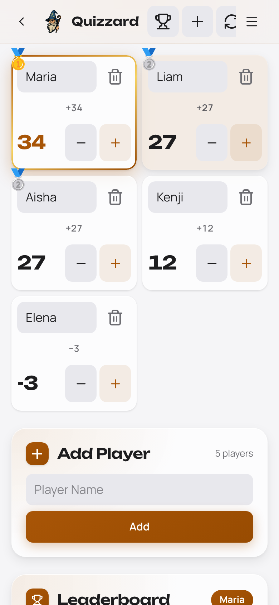

# Keep score

This guide shows you how to keep score for a game with **Scores**: add players, change their scores, take back a change, read the leaderboard and send it to a chat.

<picture>
  <source media="(prefers-color-scheme: dark)" srcset="../images/scores-game-dark.png">
  
</picture>

## Add players

1. On the home screen, select **Scores**.
2. In the **Add Player** card, enter the name in the **Player Name** field.
3. Select **Add**. With a keyboard, you can use the Enter key instead.

The player appears as a card with a score of 0. The name field stays ready for the next name.

To rename a player, edit the name in the card and select outside the field. To remove a player, see [Remove a player or reset a score](#remove-a-player-or-reset-a-score).

## Give a name a colour

Useful when every player has a colour on the table, for example the meeples in Carcassonne.

1. Select the palette button beside the name: in the **Add Player** card before you add the player, or in the player's card at any time. On a phone, and from the fifth player on, a card shows the palette in place of the trash button while you edit the name: select the name first.
2. In the **Name colour** window, select one of the seven colours (red, blue, yellow, green, black, pink, grey), or choose your own in **Custom colour** and select **Done**.

The colour fills the name field only; the rest of the card stays the same. On the seven colours the name is written in dark or white, whichever reads better; on a custom colour it is always white, so pick one that white text shows on. To take it off, open the window again and select **No colour**.


## Change a score

- To add one point, select **+** in the player's card. To subtract one point, select **−**.
- To add or subtract any amount, select the score, enter the amount in the **Custom score adjustment** field of the **Adjust score** window, and select **Apply**. Enter a negative number such as `-5` to subtract. On an iPhone or iPad the field opens the keyboard that has a minus sign; other phones show the number pad.

The card and the leaderboard show the changed score at once. If a change would take a score past a limit, Quizzard keeps the score and shows a message. See [Limits](../reference/limits.md).

## Read the cards and the leaderboard

The cards stay in the order you added the players. A medal in the corner of a card shows the place: 🥇, 🥈 or 🥉. Players with the same score share a place, so 34, 27 and 27 points give 🥇, 🥈 and 🥈. While every score is the same, no card has a medal. The card of the player whose points you entered last is tinted.

The **Leaderboard** card at the end of the page ranks the players by score, highest first. The trophy button (**Open leaderboard**) in the header opens the same list in a window.

## See and take back changes

Each card shows its most recent changes in a small line between the name and the score, for example `+5 −2 +12`. Several selections of **+** or **−** in a row within 3 seconds count as one change.

1. To see every change, select that line in the card.
2. In the window, select the **×** next to a change to take it back. The total changes at once.
3. To put the change back, select **Restore** before you close the window.

## Remove a player or reset a score

1. In the player's card, select the trash button (**Remove**, followed by the player's name).
2. In the **Remove player or score?** window, choose **Player and score** or **Score only**.
3. Select **Remove** or **Reset**.

**Player and score** takes the player out of the game. **Score only** keeps the player with 0 points. You can't undo this.

## Start over

- To play again with the same players, select **Reset scores** in the **Leaderboard** card, keep **Scores only** selected in the **Clear session?** window and select **Reset**.
- To start with no players, select **Clear session**, keep **Players and scores** selected and select **Clear**.

You can't undo either.

## Share the leaderboard

1. In the **Leaderboard** card, select **Share**. The button is turned off while the game has no players.
2. If your device opens a share sheet, choose the app and the chat. If it has none, a **Share** window opens: select **WhatsApp** or **Copy**.

If you select **Copy**, Quizzard shows "Leaderboard copied ✓". The text looks like the following example. The second line has the date and time on your device.

```text
🏆 Quizzard — Leaderboard
📅 Nov 23, 2026, 12:40 AM

🥇 34 · Maria
🥈 27 · Liam
🥈 27 · Aisha
4️⃣ 12 · Kenji
5️⃣ −3 · Elena

👑 Winner: Maria — 34 points
👥 5 players · 97 points in total

— Made with Quizzard · https://simeontsvetanov.github.io/Quizzard/
```

The text goes to the app you choose only when you select **Share**. That app's privacy terms apply after that.

## Related

- [Limits](../reference/limits.md) — players, names and scores
- [Back up and move your data](back-up-and-move-your-data.md)
- [Quizzard user documentation](../index.md)
