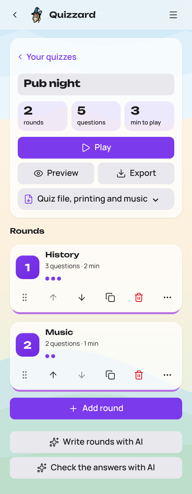

# Make a quiz

This guide shows you how to make a quiz with **Quiz creator**: name it, add rounds and questions, add pictures, audio and video, put everything in order, check it, and save it as a file. To run the finished quiz in front of a room, see [Play a quiz](play-a-quiz.md).

<picture>
  <source media="(prefers-color-scheme: dark)" srcset="../images/make-a-quiz/quiz-dark.png">
  
</picture>

A quiz is a deck of cards: its rounds are the stacks and its questions are the cards. Every change is saved on your device a moment after you make it, and **Saved** shows at the top. There is no Save button.

## Start a quiz

1. On the home screen, select **Quiz creator**. **Your quizzes** opens.
2. Select **New quiz**.
3. Enter the name of the quiz and select **Create quiz**. Nothing is created until you do; **Cancel** or the Escape key leaves without a quiz.

<picture>
  <source media="(prefers-color-scheme: dark)" srcset="../images/make-a-quiz/library-dark.png">
  
</picture>

The buttons on a quiz's card rename it, make a copy or delete it. A deleted quiz can be brought back with **Undo** for a few seconds. From six quizzes on, **Search your quizzes** finds a quiz by its name.

## Add rounds

1. Select **Add round**. The **Add a round** window opens.
2. Select the kind of round: **Standard**, **Golden pyramid**, **Safe**, **Make the quizmaster laugh** or **Free game**. A standard round opens with its name selected; any other kind opens on its questions.
3. Enter the name of the round, for example "History".
4. Optional: open **Round settings** to set **Time per question** and **Points per question**, what **New questions are** and what **New questions are answered with**, and the **Rules shown before the round (optional)**.

If some questions of the round have their own time or points, **Apply time and points to all questions** in **Round settings** gives all of them the round's values. It says how many questions change first, and **Undo** brings their own values back.

A quiz can have up to 20 rounds.

## Add a Golden pyramid or a Safe

These two special rounds come ready to fill in: their questions are already there, with their answer kind, points, time and a rules text in the quiz's language. You can change the text and, in **Round settings**, the time.

- **Golden pyramid**: 4 questions. Question 1 asks for 1 answer, question 2 for 2, question 3 for 3, question 4 for 4: 10 points in all. Under **Accepted answers**, list every answer that counts. You can list more than the question asks for, for example all 50 states for "Name 4 US states". **Enter** adds the next answer, and a list pasted with one answer per line is split. The counter says "asks for 3 · 7 accepted"; a question with fewer accepted answers than it asks for is not finished. A team scores 1 point for each of its answers on the list. A team that writes more answers than asked scores 0 for that question.
- **Safe**: 5 questions, each answered with one digit from 0 to 9; the five digits are the code of the safe. Pick the digit on the ten keys. A team scores 1 point per right digit, and all five add the **Bonus for all 5 digits** from **Round settings**: 3 unless you change it (0 to 20), so 5 + 3 = 8.

A special round always has its number of questions: there is no **Add question**, and its questions can't be duplicated, deleted or moved to another round. A line in the round says why. The questions of a Safe can change places; those of a Golden pyramid can't, because the place says how many answers a question asks for. Each question can still be text, a picture, audio or video.

## Add a round without answers

**Make the quizmaster laugh** and **Free game** have no questions to answer. Each is one screen that says what the teams do, with a timer; then you give the points. Nothing is revealed, so these rounds have no answers screen.

**Make the quizmaster laugh** needs nothing from you: add the round as in [Add rounds](#add-rounds) and it is ready.

- **What the teams see** shows the round's screen. Its explanation is built in and is shown in the language the quiz is played in.
- Optional: in **More text on the screen**, add a line of your own, for example a theme for the jokes. It is shown under the explanation.
- In **Round settings**, change **Time** (5 minutes to start with; **−** and **+** change it by half a minute) and the two prizes.

**Free game** is your own task:

1. Add the round as in [Add rounds](#add-rounds).
2. In the round, select its one screen. The editor opens.
3. In **Question**, enter what the teams see, for example "Draw the quizmaster". Until it has a text, the screen is **Not finished**.
4. Optional: under **Kind of question**, select **Picture**, **Audio** or **Video** and add a file that helps with the task.
5. Select **Done**.
6. Optional: in **Round settings**, change **Time per question** and the points.

The two rounds differ in their points:

- **Make the quizmaster laugh**: every team has 5 minutes to think up a joke, and one of them tells it. You pick the two funniest teams. **Points for first place** (3) and **Points for second place** (1) set the prizes; every other team scores 0.
- **Free game**: your own task, such as drawing, building or singing, for 3 minutes. **Most points for a team** (3) is the most you can give one team.

For another task, add another **Free game**.

## Add questions

1. In the round, select **Add question**. The editor opens.
2. Under **Kind of question**, select **Text**, **Picture**, **Audio** or **Video**.
3. Enter the question in **Question**.
4. For a picture, audio or video question, select **Choose a picture**, **Choose an audio file** or **Choose a video**. On a computer you can also drop a file on the area or paste one. If an audio or video file is too big or in another format, the cut window opens; see [Cut and shrink a clip](#cut-and-shrink-a-clip).
5. Under **How it is answered**, select **Open answer**, **Multiple choice** or **True / false**, and enter the answer. For **Multiple choice**, enter 2 to 8 options and tick every correct one in the **Correct** column.
6. Optional: change **Time** and **Points** for this question.
7. Optional: enter an **Explanation shown with the answer (optional)**. It can be up to 700 characters, and the stage shows all of it with the answer.
8. Optional: under **Picture with the answer (optional)**, select **Picture for the answer** and choose a picture. It is shown when the answer is revealed, in place of the question's own picture or clip.
9. Optional: enter a **Host note (optional)**. The host note is for you alone: it shows in the editor and on the host panel, never on the stage.
10. Select **Add another** to go straight to the next question, or **Done** to go back to the round.

<picture>
  <source media="(prefers-color-scheme: dark)" srcset="../images/make-a-quiz/editor-dark.png">
  
</picture>

A question you add starts as the kind and answer type you used last in that round. The arrows next to the title go to the previous and the next question. **In round** moves the question to another round. At the end of the form, **Duplicate question** makes a copy and **Delete question** removes the question; **Undo** brings it back.

With a keyboard, Ctrl + Enter (⌘ + Enter on a Mac) is **Add another**, Alt + ↑ and Alt + ↓ go to the previous and next question, and in **Multiple choice** the Enter key goes to the next option and adds one after the last.

A picture wider or taller than 1,920 pixels is scaled down when you add it, so a photo of up to 60 MB can be picked. When you remove or replace a picture, audio or video file, or change the kind of the question so that the file no longer fits, a message with **Undo** shows for a few seconds.

## Cut and shrink a clip

When an audio or video file is too big for a quiz, or in a format a quiz doesn't take (such as a phone's MOV or a WAV), the cut window opens when you pick it. For a file that already fits, select **Cut** next to **Replace** to open the same window.

1. Move the two handles on the bar to the start and the end of the part you want to keep. For a video the bar shows its frames; for a sound, its loudness.
2. Optional: select **Play the chosen part** to check it.
3. For a video, choose the **Picture size**: **As it is**, **1080p**, **720p** or **480p**.
4. Choose the **Quality**: **High**, **Medium** or **Low (smallest file)**.
5. Select **Cut and shrink**.

The smaller file goes on the question. If it is still over the limit, the window says so and stays open: keep a shorter part or pick a lower quality. If you close the window without cutting, the question says why the file isn't in, and **Cut and shrink** is the highlighted button.

The cut happens on your device; nothing is uploaded. It needs a browser that can re-encode video and sound: Chrome, Edge, Safari 26 or later, or Firefox on a computer. In other browsers, such as older Safari or Firefox on Android, a file over the limit is refused with the reason.

## Put rounds and questions in order

A round's card and a question's card have the same row of buttons:

| Button | What it does |
|---|---|
| Handle (six dots) | Drag the card to another place. With a keyboard, the arrow keys on the handle move the card one place. |
| Arrow up, arrow down | Move the card one place. |
| Two squares | Duplicate the card. |
| Bin | Delete the card. A round with questions asks first. **Undo** brings a deleted card back. |
| Three dots (**More**) | For a round: **Preview this round**, **Play from this round**, **Move to the top** and **Move to the bottom**. For a question: **Preview**, **Play from here**, **Move to the top**, **Move to the bottom** and **Move to round…**. |

For a long round, select **List** over the questions. Each question is then one short row. **Cards** shows the small slides again. Quizzard remembers the choice on this device.

## Check the quiz

- A question without a text, a file or an answer is marked **Not finished**. The round and the quiz show how many there are; select the message to open the first one.
- Select **Preview** to see the questions as they will be played. **Show answer** shows the reveal.
- Select **Play** to run the whole quiz. If questions are not finished, Quizzard lists them first. Select one to finish it, or select **Play anyway**.

## Save, share and print

Select **Quiz file and printing** on the quiz to open these tools:

- **Save quiz file** saves the quiz with its pictures, audio and video as one `.quizzard` file. Use it as your backup and to move the quiz to another device. On a phone, **Share** sends the same file.
- **Print answers** prints a sheet for the host: every question with its answer, explanation, host note and points, one round to a page.

To open a quiz file, select **Open a quiz file** in **Your quizzes**. If the quiz is already there in another version, choose **Cancel**, **Keep both** or **Replace**. **Undo** takes a replacement back.

To make a file that plays the quiz on a TV, see [Play on a TV or projector](play-a-quiz.md#play-on-a-tv-or-projector).

## Related

- [Play a quiz](play-a-quiz.md)
- [Limits](../reference/limits.md): characters, files, rounds and points
- [Privacy and data](../about/privacy-and-data.md)
- [Quizzard user documentation](../index.md)
