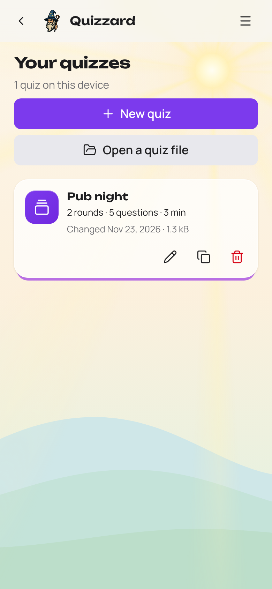
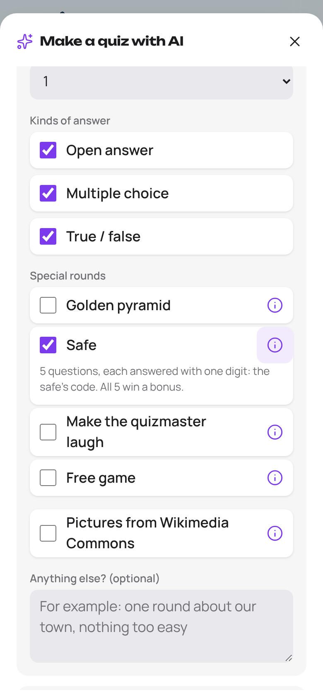
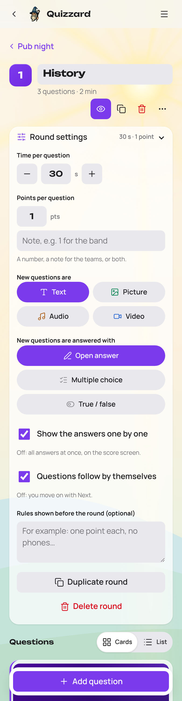
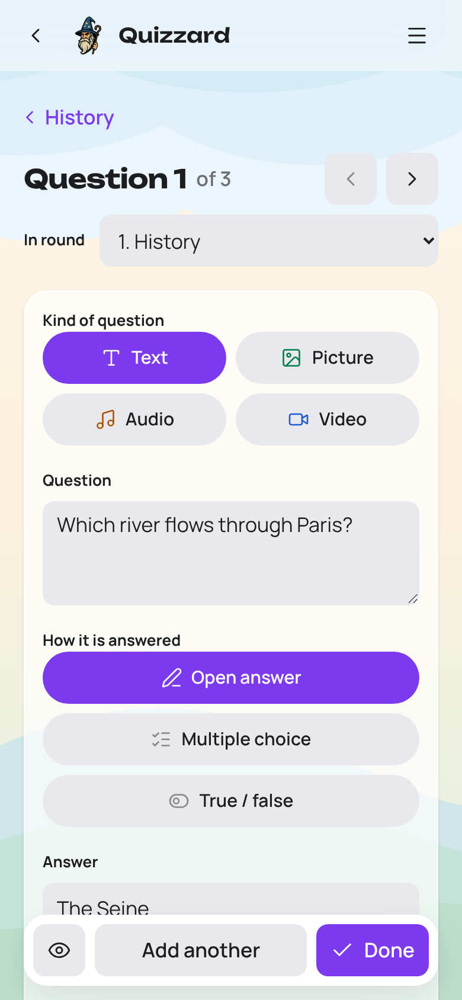
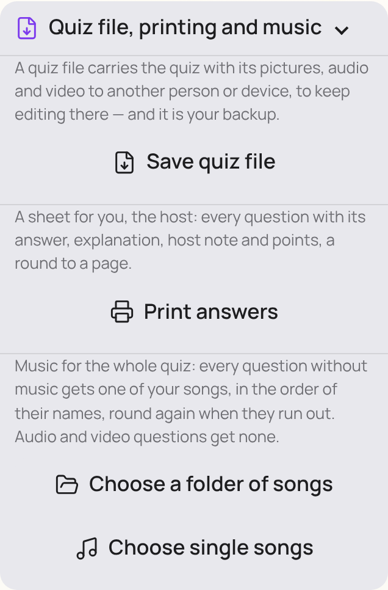

# Make a quiz

This guide shows you how to make a quiz with **Quiz creator**: name it, add rounds and questions, add pictures, audio and video, put everything in order, check it, and save it as a file. To run the finished quiz in front of a room, see [Play a quiz](play-a-quiz.md).

<picture>
  <source media="(prefers-color-scheme: dark)" srcset="../images/make-a-quiz/quiz-dark.png">
  
</picture>

A quiz is a deck of cards: its rounds are the stacks and its questions are the cards. Every change is saved on your device a moment after you make it, and **Saved** shows at the top. There is no Save button.

## Start a quiz

1. On the home screen, select **Quiz creator**. **Your quizzes** opens.
2. Select **New quiz**.
3. Enter the name of the quiz and select **Create quiz**. Nothing is created until you do; **Cancel** or the Escape key leaves without a quiz.

<picture>
  <source media="(prefers-color-scheme: dark)" srcset="../images/make-a-quiz/library-dark.png">
  
</picture>

The buttons on a quiz's card rename it, make a copy or delete it. A deleted quiz can be brought back with **Undo** for a few seconds. From six quizzes on, **Search your quizzes** finds a quiz by its name.

## Let your AI assistant write the quiz

Your own assistant — ChatGPT, Gemini, Claude or another — can write the questions. Quizzard does not talk to it: you carry a text to the assistant and its answer back.

1. In **Your quizzes**, select **Make a quiz with AI**.
2. Under **What do you want?**, choose the topic, who plays, the difficulty, the language, the number of rounds and questions, the time and points, the kinds of answer and the special rounds. The **ⓘ** beside a special round says what it is. Your choices are kept for the next time.
   <picture>
     <source media="(prefers-color-scheme: dark)" srcset="../images/make-a-quiz/ai-dark.png">
     
   </picture>

3. Under **Give it to your assistant**, select your assistant, then **Copy and open ChatGPT** (or Gemini, Claude; **Copy the instructions** for another assistant) — the instructions are copied and the assistant opens in a new tab. Paste them into a new chat. On a phone, **Share to an app** sends them straight to the assistant's app.
4. The assistant answers with one block of code. Select the Copy button on that block, come back to Quizzard, select **Paste**, then **Make the quiz**. For a long quiz in several blocks, copy and paste each block in order first.

The quiz opens, ready to edit and play. The assistant writes text questions (open answer, multiple choice, true / false) and the rounds Golden pyramid, Safe, Make the quizmaster laugh and Free game.

If something in the answer does not fit, Quizzard lists what must be fixed, in the language of the app. Select **Copy for the assistant**, paste the list into the chat, and paste the corrected answer back: **Paste** puts it in place of the old one.

Check the answers before you play: an assistant can get a fact wrong.

### Pictures from Wikimedia Commons

Tick **Pictures from Wikimedia Commons** and the assistant adds photos to some questions — only files of [Wikimedia Commons](https://commons.wikimedia.org/), which are free to use. Quizzard downloads each one, makes it the right size and shows its author and licence in a corner of the picture. A file name that does not exist on Commons is listed as a problem for the assistant to fix, so a made-up picture never gets in. This works with an assistant that can open web pages; downloading needs an internet connection.

### More rounds, more questions, a check of the answers

- In a quiz, **Write rounds with AI** asks your assistant for new rounds; it sees the questions the quiz already has, so it does not repeat them. They are added after the quiz's rounds, and **Undo** takes them away again.
- In a standard round, **Write questions with AI** adds questions at the end of the round, with the round's time and points.
- **Check the answers with AI** gives your assistant every question with its answer. Paste its answer and select **Show the results**: each question it doubts — or a whole round, or the quiz — is listed with what is wrong and its suggestion, and **Open the question** takes you to the question. Nothing changes by itself.

### Share the answer to Quizzard (Android)

With Quizzard installed on an Android phone, you can also select **Share** on the assistant's answer and pick **Quizzard**: the AI window you copied the instructions from opens again — in its quiz or round — with the answer already pasted.

## Add rounds

1. Select **Add round**. The **Add a round** window opens.
2. Select the kind of round: **Standard**, **Golden pyramid**, **Safe**, **Make the quizmaster laugh** or **Free game**. A standard round opens with its name selected; any other kind opens on its questions, and **Make the quizmaster laugh** on its one screen.
3. Enter the name of the round, for example "History".
4. Optional: open **Round settings** to set **Time per question** and **Points per question**, whether to **Show the answers one by one** (off: all answers at once with the score entry) and whether **Questions follow by themselves** (off: you move on with **Next**), what **New questions are** and what **New questions are answered with**, and the **Rules shown before the round (optional)**.

If some questions of the round have their own time or points, **Apply time and points to all questions** in **Round settings** gives all of them the round's values. It says how many questions change first, and **Undo** brings their own values back.

A quiz can have up to 20 rounds.

<picture>
  <source media="(prefers-color-scheme: dark)" srcset="../images/make-a-quiz/round-dark.png">
  
</picture>

## Add a Golden pyramid or a Safe

These two special rounds come ready to fill in: their questions are already there, with their answer kind, points, time and a rules text in the quiz's language. You can change the text and, in **Round settings**, the time.

- **Golden pyramid**: 4 questions. Question 1 asks for 1 answer, question 2 for 2, question 3 for 3, question 4 for 4: 10 points in all. Under **Accepted answers**, list every answer that counts. You can list more than the question asks for, for example all 50 states for "Name 4 US states". **Enter** adds the next answer, and a list pasted with one answer per line is split. The counter says "asks for 3 · 7 accepted"; a question with fewer accepted answers than it asks for is not finished. A team scores 1 point for each of its answers on the list. A team that writes more answers than asked scores 0 for that question.
- **Safe**: 5 questions, each answered with one digit from 0 to 9; the five digits are the code of the safe. Pick the digit on the ten keys. A team scores 1 point per right digit, and all five add the **Bonus for all 5 digits** from **Round settings**: 3 unless you change it (0 to 20), so 5 + 3 = 8.

A special round always has its number of questions: there is no **Add question**, and its questions can't be duplicated, deleted or moved to another round. A line in the round says why. The questions of a Safe can change places; those of a Golden pyramid can't, because the place says how many answers a question asks for. Each question can still be text, a picture, audio or video.

## Add a round without answers

**Make the quizmaster laugh** and **Free game** have no questions to answer. Each is one screen that says what the teams do, with a timer; then you give the points. Nothing is revealed, so these rounds have no answers screen.

**Make the quizmaster laugh** needs nothing from you: add the round as in [Add rounds](#add-rounds) and it is ready.

- **What the teams see** shows the round's screen. Its explanation is built in and is shown in the language the quiz is played in.
- Optional: in **More text on the screen**, add a line of your own, for example a theme for the jokes. It is shown under the explanation.
- In **Round settings**, change **Time** (5 minutes to start with; **−** and **+** change it by half a minute) and the two prizes.

**Free game** is your own task:

1. Add the round as in [Add rounds](#add-rounds).
2. In the round, select its one screen. The editor opens.
3. In **Question**, enter what the teams see, for example "Draw the quizmaster". Until it has a text, the screen is **Not finished**.
4. Optional: under **Kind of question**, select **Picture**, **Audio** or **Video** and add a file that helps with the task.
5. Select **Done**.
6. Optional: in **Round settings**, change **Time per question** and the points.

The two rounds differ in their points:

- **Make the quizmaster laugh**: every team has the round's time (5 minutes to start with) to think up a joke, and one of them tells it. You pick the two funniest teams. **Points for first place** (3) and **Points for second place** (1) set the prizes; every other team scores 0.
- **Free game**: your own task, such as drawing, building or singing, for 3 minutes. **Most points for a team** (3) is the most you can give one team.

For another task, add another **Free game**.

## Add questions

1. In the round, select **Add question**. The editor opens.
2. Under **Kind of question**, select **Text**, **Picture**, **Audio** or **Video**.
3. Enter the question in **Question**.
4. For a picture, audio or video question, select **Choose a picture**, **Choose an audio file** or **Choose a video**. On a computer you can also drop a file on the area or paste one. If an audio or video file is too big or in another format, the cut window opens; see [Cut and shrink a clip](#cut-and-shrink-a-clip).
5. Under **How it is answered**, select **Open answer**, **Multiple choice** or **True / false**, and enter the answer. For **Multiple choice**, enter 2 to 8 options and tick every correct one in the **Correct** column.
6. Optional: change **Time** and **Points** for this question.
7. Optional: enter an **Explanation shown with the answer (optional)**. It can be up to 700 characters, and the stage shows all of it with the answer.
8. Optional: under **Picture, audio or video with the answer (optional)**, select **File for the answer** and choose a picture, an audio clip or a video. It is shown or played when the answer is revealed, in place of the question's own picture or clip. A clip that is too long or too big opens the cut window, as in a question.
9. Optional: enter a **Host note (optional)**. The host note is for you alone: it shows in the editor and on the host panel, never on the stage.
10. Select **Add another** to go straight to the next question, or **Done** to go back to the round.

<picture>
  <source media="(prefers-color-scheme: dark)" srcset="../images/make-a-quiz/editor-dark.png">
  
</picture>

A question you add starts as the kind and answer type you used last in that round. The arrows next to the title go to the previous and the next question. **In round** moves the question to another round. At the end of the form, **Duplicate question** makes a copy and **Delete question** removes the question; **Undo** brings it back.

With a keyboard, Ctrl + Enter (⌘ + Enter on a Mac) is **Add another**, Alt + ↑ and Alt + ↓ go to the previous and next question, and in **Multiple choice** the Enter key goes to the next option and adds one after the last.

A picture wider or taller than 1,920 pixels is scaled down when you add it, so a photo of up to 60 MB can be picked. When you remove or replace a picture, audio or video file, or change the kind of the question so that the file no longer fits, a message with **Undo** shows for a few seconds.

## Cut and shrink a clip

When an audio or video file is too big for a quiz, or in a format a quiz doesn't take (such as a phone's MOV or a WAV), the cut window opens when you pick it. For a file that already fits, select **Cut** next to **Replace** to open the same window.

1. Move the two handles on the bar to the start and the end of the part you want to keep. For a video the bar shows its frames; for a sound, its loudness.
2. Optional: select **Play the chosen part** to check it.
3. For a video, choose the **Picture size**: **As it is**, **1080p**, **720p** or **480p**.
4. Choose the **Quality**: **High**, **Medium** or **Low (smallest file)**.
5. Select **Cut and shrink**.

The smaller file goes on the question. If it is still over the limit, the window says so and stays open: keep a shorter part or pick a lower quality. If you close the window without cutting, the question says why the file isn't in, and **Cut and shrink** is the highlighted button.

The cut happens on your device; nothing is uploaded. It needs a browser that can re-encode video and sound: Chrome, Edge, Safari 26 or later, or Firefox on a computer. In other browsers, such as older Safari or Firefox on Android, a file over the limit is refused with the reason.

## Put rounds and questions in order

A round's card and a question's card have the same row of buttons:

| Button | What it does |
|---|---|
| Handle (six dots) | Drag the card to another place. With a keyboard, the arrow keys on the handle move the card one place. |
| Arrow up, arrow down | Move the card one place. |
| Two squares | Duplicate the card. |
| Bin | Delete the card. A round with questions asks first. **Undo** brings a deleted card back. |
| Three dots (**More**) | For a round: **Preview this round**, **Play from this round**, **Move to the top** and **Move to the bottom**. For a question: **Preview**, **Play from here**, **Move to the top**, **Move to the bottom** and **Move to round…**. |

For a long round, select **List** over the questions. Each question is then one short row. **Cards** shows the small slides again. Quizzard remembers the choice on this device.

## Check the quiz

- A question without a text, a file or an answer is marked **Not finished**, and its card has a red edge and a red light. The round and the quiz show how many there are; select the message to open the first one.
- A long question, answer or explanation is never cut: the slide draws the texts smaller until all of them fit. The preview beside the editor shows the result.
- Select **Preview** to see the questions as they will be played. **Show answer** shows the reveal.
- Select **Play** to run the whole quiz. If questions are not finished, Quizzard lists them first. Select one to finish it, or select **Play anyway**.

## Keep the questions out of sight

The questions of a round are blurred when you open the quiz, in case the players can see your screen. To read them, select the eye button (**Show the questions**) in the round's header, beside copy and delete. Select it again to blur them. A question you open is always readable in its editor.

## Add music

Music plays while a question's time runs, so the teams can talk without the next table hearing them. It starts by itself with the timer and stops with it; a song shorter than the time goes round. A question with audio or video has no music.

To give one question a song:

1. Open the question and select **Music while the time runs (optional)**.
2. Select **Song for this question** and choose an MP3 or M4A file. A longer song opens the cut window, as any audio clip.

To add music to the whole quiz:

1. On the quiz, select **Quiz file, printing and music**.
2. Select **Choose a folder of songs** (on a computer) or **Choose single songs** and choose your songs.

Every question without music gets one of the songs, in the order of their names. With fewer songs than questions, the songs start again from the first. A question that already has a song keeps it. Where the browser can cut a clip, each song is cut to the time of its question.

<picture>
  <source media="(prefers-color-scheme: dark)" srcset="../images/make-a-quiz/music-dark.png">
  
</picture>

When you add questions later, the quiz shows how many have no music, for example **2 questions have no music**. Select the message to see them, such as "Round 1 (History) – question 3", and select **Choose songs** to fill them. **Remove the music** takes the music off every question; **Undo** brings it back.

## Save, share and print

Select **Quiz file, printing and music** on the quiz to open these tools:

- **Choose a folder of songs** and **Choose single songs** add music to the whole quiz, see [Add music](#add-music).

- **Save quiz file** saves the quiz with its pictures, audio and video as one `.quizzard` file. Use it as your backup and to move the quiz to another device. On a phone, **Share** sends the same file.
- **Print answers** prints a sheet for the host: every question with its answer, explanation, host note and points, one round to a page.

To open a quiz file, select **Open a quiz file** in **Your quizzes**. If the quiz is already there in another version, choose **Cancel**, **Keep both** or **Replace**. **Undo** takes a replacement back.

To make a file that plays the quiz on a TV, see [Play on a TV or projector](play-a-quiz.md#play-on-a-tv-or-projector).

## Related

- [Play a quiz](play-a-quiz.md)
- [Limits](../reference/limits.md): characters, files, rounds and points
- [Privacy and data](../about/privacy-and-data.md)
- [Quizzard user documentation](../index.md)
