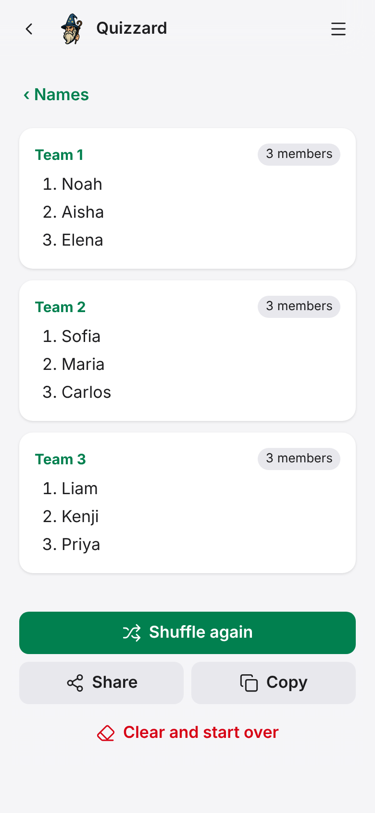

# Make teams

This guide shows you how to split a group of people into fair random teams with **Teams**, shuffle again and send the result to a chat.

## Make the teams

1. On the home screen, select **Teams**.
2. In the **Names** box, type or paste the names, one per line.
3. Under **Teams**, select **+** or **−** until the number you want shows. The choice is 2 to 10 teams.
4. Select **Generate teams**.

The **Your teams** list shows each team with its number of members, and a line such as "3 teams are ready". Team sizes differ by at most one person, and the bigger teams come first. Every possible split is equally likely.

<picture>
  <source media="(prefers-color-scheme: dark)" srcset="../images/teams-result-dark.png">
  
</picture>

On a phone, the teams are the next screen. To go back to the list of names, select **‹ Names**. On a wider screen, the names and the teams are side by side.

## Paste a list from a chat

If you paste a list from a chat or a note, Quizzard removes list numbers, bullets, emoji and chat prefixes such as `[18:03] Name:`, and keeps the names. A line such as `Ana, Boris; Vesko` becomes three names. Blank lines are ignored, and two people can have the same name.

With a keyboard, you can use Ctrl+Enter (⌘+Enter on a Mac) in the **Names** box instead of selecting **Generate teams**.

## Shuffle again

If you don't like the split, select **Shuffle again**. The same names are split again at random.

## Copy or share the teams

- To copy the teams as text, select **Copy**. Quizzard shows "Teams copied ✓".
- To send the teams to a chat, select **Share**. If your device has a share sheet, choose the app there. If it has none, which is common on computers, a **Share** window opens with **WhatsApp** and **Copy**.

The text has a heading, one block per team and a last line "— Made with Quizzard" with a link, as in the following example. A number follows the name. It counts how many times in a row you made teams from the same list: `Quizzard1` the first time, `Quizzard2` after one **Shuffle again**.

```text
✨ TEAMS GENERATED ✨

🏆 Team 1 | Members - 3
  👤 Noah
  👤 Aisha
  👤 Elena

🏆 Team 2 | Members - 3
  👤 Sofia
  👤 Maria
  👤 Carlos

— Made with Quizzard1 · https://simeontsvetanov.github.io/Quizzard/
```

The text goes to the app you choose only when you select **Share** or **WhatsApp**. That app's privacy terms apply after that.

## Start over

- To empty the list of names, select **Clear** next to the name count. **Undo** brings the list back for a few seconds.
- To remove the names and the teams, select **Clear and start over**, then **Clear** in the **Clear the names and teams?** window.

Quizzard keeps the last list of names and the number of teams on this device, so a weekly game starts where you left it.

## If Quizzard shows a message

- "Add at least two names, one per line." — the list has fewer than two names.
- "Choose between 2 and 10 teams." — the number of teams is outside the range.
- "You have 3 names — add more names or choose fewer than 4 teams." — there are more teams than names. The numbers in the message are the ones you have.

See [Limits](../reference/limits.md) for the numbers.

## Related

- [Limits](../reference/limits.md) — names and teams
- [Back up and move your data](back-up-and-move-your-data.md)
- [Quizzard user documentation](../index.md)
