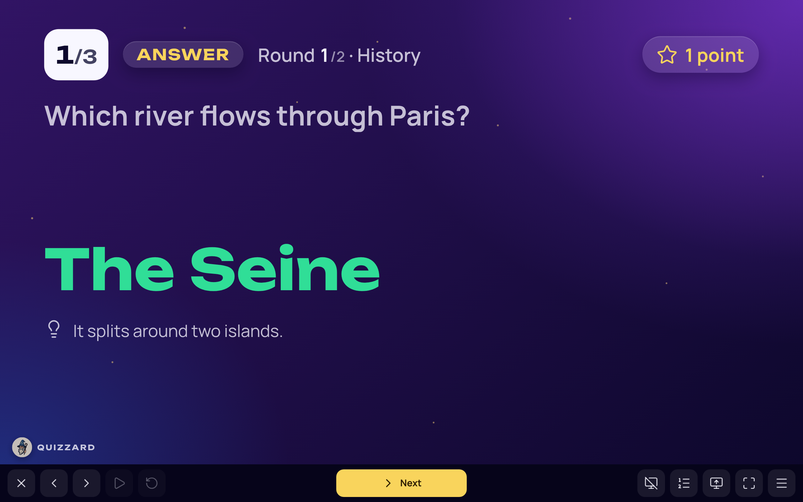
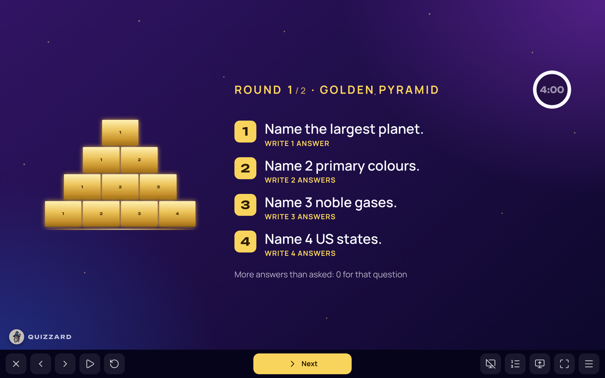
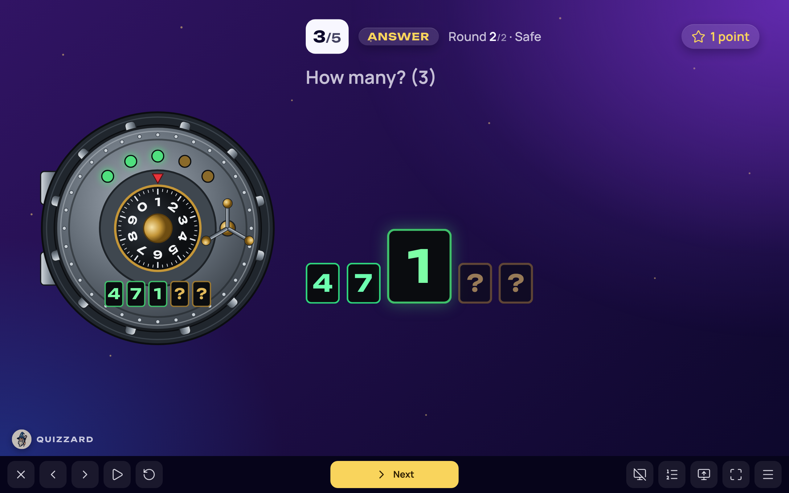
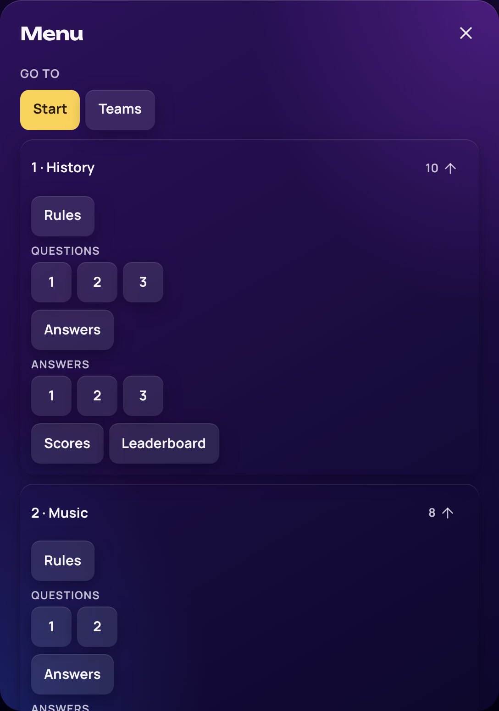

# Play a quiz

This guide shows you how to run a quiz you made with **Quiz creator**: in Quizzard itself, on a TV or projector from one exported file, and with a second window for the audience. To make the quiz first, see [Make a quiz](make-a-quiz.md).

<picture>
  <source media="(prefers-color-scheme: dark)" srcset="../images/play-a-quiz/stage-dark.png">
  
</picture>

## Play in Quizzard

1. Open the quiz and select **Play**. To start in the middle, select the three dots (**More**) on a round or a question and then **Play from this round** or **Play from here**.
2. On the title screen, select **Start**.
3. On **Teams**, enter each team's name. **Add team** adds a team; a game takes 2 to 12 teams and starts with 4.
4. Select **Next** to go on. Each round shows its rules, its questions with their timer, the **Answers** one by one, the **Scores** and the **Leaderboard**. The game ends with the **Final result**.
5. To leave, select the cross (**Back to the quiz**). The game is saved, and **Play** continues where you left it.

When you open a game you left, a message says "Continuing your last game". To play from the beginning, select **Start again** on that message: it clears the points and goes back to the first screen.

If first place is shared at the end, **A tie for first place** shows the teams that are level. Play a tiebreak question, then select **Winner** on one team or give it a point with the plus button.

## What the stage shows

- **Where you are:** the question as "3/10" and the round as "Round 1/3", with the total dimmer.
- **The timer:** seconds, or a clock such as "5:00" for a time over 99 seconds. A round's rules give whole minutes as minutes, for example "5 min per question".
- **The answer:** each answer is one slide and one press of **Next**. The question stands at the top, smaller, and about a second later the answer comes in as the large text in the middle. The explanation shows in full under it; a long one is set smaller. If the question has a file with its answer (**Picture, audio or video with the answer (optional)**), that picture or clip takes the place of the question's own picture or clip.

<picture>
  <source media="(prefers-color-scheme: dark)" srcset="../images/play-a-quiz/answer-dark.png">
  
</picture>

- **The Quizzard logo:** large on the title and the final screen, small in a corner on the others. In an exported quiz the logo is a link to the Quizzard website, which opens in another tab.

The screen stays awake while you play.

## Show pictures, audio and video

A picture or a video is as large as the slide allows. To show it over the whole stage, select the picture, or the zoom button in the corner of the video, or press Z. Press Esc or Z to go back; a video keeps playing.

A question with music plays its song by itself while the timer runs: pausing the timer rests it, and it stops when the time is up. The song plays from your own window, also when the audience window is open.

An audio or video clip never starts by itself. Select **Next** (it reads **Play the clip**), the forward arrow, Space or →: the first press plays the clip and the next one moves on. Its own play button and P work too. On a question with a clip, the timer starts together with the clip; T starts it at any time. When the time is up the game goes on by itself, and a next question with a clip plays at once.

A clip that is longer than the time of its question plays from its start and stops when that time has played: with 30 seconds set, 30 seconds play. **Play** starts it again from the beginning. A shorter clip plays to its own end. When the answer is shown, the clip plays in full.

## Enter the scores

After the answers of a round, the **Scores** screen lists all of them in short, for example "1 — A: Caterpillar", "2 — True", "3 — A cow". On a computer or TV the list stands beside the points of each team. On a phone the list comes first, and **Next** brings the points.

Enter each team's points with the field or the plus and minus buttons. Next to them, **Points in this round** shows what each question gives. To correct a round later, select **Scores** in the control bar or press S: a table shows every team's points per round, and you can change any number.

To start a break from the score screen, select **5 min**, **10 min** or **15 min** next to **Break**. During a break the stage shows the countdown, the standings so far and the answers of the round that ended. If the quiz has music, the break plays its songs one after the other from the first; pausing the break rests the music, and it stops when the break ends.

## Play the special rounds

- **Golden pyramid:** one screen shows the pyramid of gold blocks beside all four questions, each with how many answers it asks for. The timer is the four questions' times together: 2 minutes each make 8. Then the answers come one by one: at each answer its blocks turn over and the accepted answers appear, the first 12, then "+N more".

<picture>
  <source media="(prefers-color-scheme: dark)" srcset="../images/play-a-quiz/pyramid-dark.png">
  
</picture>

- **Safe:** a vault door. After **Answers**, one press of **Next** dials the whole code: each digit's slide turns the dial, clicks the digit into its window and gives way to the next by itself, and after the fifth the door opens. The digits found so far stay beside the vault, and the timer button pauses the sequence. With **Show the answers one by one** off, one slide shows the whole code. At score entry you enter each team's right digits (0 to 5); all five add the bonus, shown as "5 + 3 bonus".

<picture>
  <source media="(prefers-color-scheme: dark)" srcset="../images/play-a-quiz/safe-dark.png">
  
</picture>

- **Make the quizmaster laugh** and **Free game:** the rules with the prizes, the task with its timer, the points and the leaderboard. The task of **Make the quizmaster laugh** is built in and is shown in the language you play in, with your own text under it if you added one. There are no answers to show. In **Make the quizmaster laugh**, give the prize for first place to the funniest team and the prize for second place to the next one.

Each special round opens with a short animated explanation of how it scores.

## The control bar

The same bar is under the stage and, when the audience window is open, under the host panel. Each button shows its name and its key when you point at it. From left to right:

| Button | Key | What it does |
|---|---|---|
| **Back to the quiz** | | Leaves the game. |
| **Back** | ← or Page Up | The screen before. |
| **Start timer** / **Pause timer** | T | Starts or pauses the question's timer. |
| **Restart timer** | R | Sets the timer back to the full time. |
| **Start**, **Next** or **Play the clip** | Space, → or Page Down | Goes on. The button stays in the same place whatever it says. |
| **Black screen** | B | Covers the stage until you select it again or go on. |
| **Scores** | S | Shows and corrects every round's points. |
| **Open audience window** / **Close audience window** | | Shows the stage alone in a second window, or closes it. |
| **Full screen** | F | Fills the screen with the stage. |
| **Menu** | M | Every screen to jump to, the switches, a break, the language and the keys. |

Two keys have no button in the bar: P plays or pauses the clip, and Z enlarges the picture or video. On a phone the bar keeps **Back to the quiz**, **Back**, the timer, the main button and **Menu**; the other tools are in the menu. A presentation clicker works: it sends the Page keys.

## The menu

<picture>
  <source media="(prefers-color-scheme: dark)" srcset="../images/play-a-quiz/menu-dark.png">
  
</picture>

The menu has the following parts, from top to bottom:

- **Go to** jumps to any screen. In a long quiz only the round you are in shows its screens; select the number after a round's name to see the others.
- **Questions run by themselves** starts the timer with each question and goes on to the next one when time is up. Turn it off to do both yourself.
- **Sound when time is up** plays a soft sound when a question's time runs out. It is off until you turn it on.
- **Pause the room** has **Black screen** and **Break · 5 min**, **Break · 10 min** and **Break · 15 min**, which count down on the stage. While a break runs, **End the break** ends it. The timer and the clip wait meanwhile.
- **Scores**, **Open audience window**, **Full screen** and **Back to the quiz**.
- **Language** switches the stage, the buttons and the menu between **English** and **Български**, whatever language the quiz is in. The questions stay as you wrote them. The game stays where it is, and Quizzard remembers the choice for that quiz.
- **Keys** lists every key.
- **Start the game again** clears every team's points and goes back to the first screen. It asks first, keeps the team names, and **Undo** brings the game back for a few seconds.

Removing a team that already has points asks first too.

## Play on a TV or projector

1. On the quiz, select **Export**. Quizzard saves one `.html` file.
2. Copy the file to the computer connected to the TV or projector and open it in a browser. It needs no internet and no Quizzard.
3. Select **Full screen** or press F.

The exported file is a copy of the quiz as it was. Export again after you change the quiz. A file over 100 MB asks first, because it may not open on a phone.

## Use a host panel and an audience window

With two screens, select **Open audience window** and move that window to the TV. Sound and video play in the audience window; if the browser wants a tap there first, it shows **Tap to play**.

Your own window becomes the **Host panel**. It has the following cards:

- **On the big screen** and **Next**: what the room sees and what comes after it.
- **Timer**: **Start timer** or **Pause timer**, and **Restart timer**.
- **Break**: **5 min**, **10 min** or **15 min** at any time. While a break runs, the card shows its time, **Pause the break** or **Resume the break**, and **End the break**. A paused break says "Paused" on the big screen.
- The clip's play and pause, **From the start**, and **Enlarge** for the picture or video in the audience window.
- **Answer**: the right answer and your host note, before anything is revealed.
- The team names and the score entry of the screen on show.
- **Scores**: every team's points per round, which you can correct right there.

The control bar under the panel is the same as under the stage.

## Related

- [Make a quiz](make-a-quiz.md)
- [Limits](../reference/limits.md): teams, points and file sizes
- [Quizzard user documentation](../index.md)
