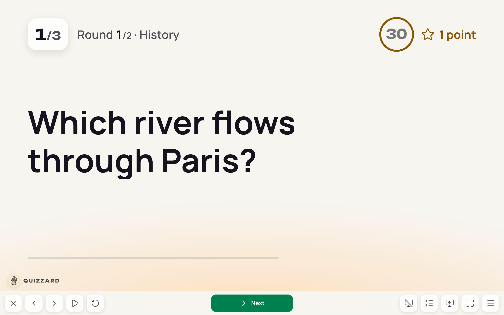

# Play a quiz

This guide shows you how to run a quiz you made with **Quiz creator**: in Quizzard itself, on a TV or projector from one exported file, and with a second window for the audience. To make the quiz first, see [Make a quiz](make-a-quiz.md).

<picture>
  <source media="(prefers-color-scheme: dark)" srcset="../images/play-a-quiz/stage-dark.png">
  
</picture>

## Play in Quizzard

1. Open the quiz and select **Play**. To start in the middle, select the three dots (**More**) on a round or a question and then **Play from this round** or **Play from here**.
2. On the title screen, select **Start**.
3. On **Teams**, enter each team's name. **Add team** adds a team; a quiz takes 2 to 12 teams.
4. Select **Next** to go on. The game shows each round's rules, its questions with their timer, the answers one by one (**Show answer**), score entry and the **Leaderboard**, and ends with the podium.
5. To leave, select the cross (**Back to the quiz**). The game is saved: **Play** continues where you left.

The stage shows where you are as "3/10": the question you are on, and out of how many. The round is shown the same way. The screen stays awake while you play.

## The control bar

The same bar is under the stage and, when the audience window is open, under the host panel. From left to right:

| Button | Key | What it does |
|---|---|---|
| **Back to the quiz** | | Leaves the game. |
| **Back** | ← or Page Up | The screen before. |
| **Start timer** / **Pause timer** | T | Starts or pauses the question's timer. |
| **Restart timer** | R | Sets the timer back to the full time. |
| **Start**, **Next** or **Show answer** | Space, → or Page Down | Goes on. The button stays in the same place whatever it says. |
| **Black screen** | B | Covers the stage until you select it again or go on. |
| **Scores** | S | Shows and corrects every round's points. |
| **Open audience window** | | Shows the stage alone in a second window; select it again to close that window. |
| **Full screen** | F | Fills the screen with the stage. |
| **Menu** | M | Every screen to jump to, a break, the switches and the keys. |

On a phone the bar keeps **Back to the quiz**, **Back**, the timer, the main button and **Menu**; the other tools are in the menu. A presentation clicker works: it sends the Page keys.

## The menu

<picture>
  <source media="(prefers-color-scheme: dark)" srcset="../images/play-a-quiz/menu-dark.png">
  
</picture>

- **Go to** jumps to any screen. In a long quiz only the round you are in shows its screens; select the number after a round's name to see the others.
- **Questions run by themselves** starts the timer with each question and moves on when time is up. Switch it off to do both yourself.
- **Sound when time is up** plays a soft sound when a question's time runs out. It is off until you switch it on.
- **Break · 5 min**, **Break · 10 min** and **Break · 15 min** show a countdown on the stage. The same three buttons are on the score screen after every round. During a break the stage also shows the standings so far and the answers of the round just played.
- **Start the game again** clears every team's points and goes back to the first screen. It asks first, keeps the team names, and **Undo** brings the game back for a few seconds.

Removing a team that already has points asks first too.

## Play on a TV or projector

1. On the quiz, select **Export**. Quizzard saves one `.html` file.
2. Copy the file to the computer connected to the TV or projector and open it in a browser. It needs no internet and no Quizzard.
3. Select **Full screen** or press F.

The exported file is a copy of the quiz as it was. Export again after you change the quiz.

With two screens, select **Open audience window** and move that window to the TV. Your own window becomes the host panel: what the room sees, what comes next, the answer and your host note before anything is revealed, the timer and score entry.

## Related

- [Make a quiz](make-a-quiz.md)
- [Limits](../reference/limits.md)
- [Quizzard user documentation](../index.md)
