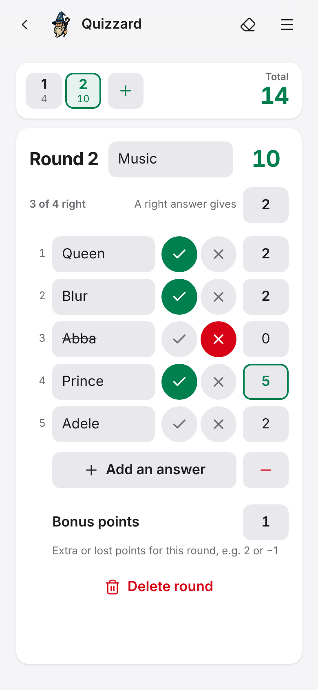

# Use the answer sheet

This guide shows you how to write your team's answers at a pub quiz with **Answer sheet**, mark them right or wrong when they are read out, and see the points of each round and the total.

<picture>
  <source media="(prefers-color-scheme: dark)" srcset="../images/answer-sheet-dark.png">
  
</picture>

The top bar shows one tab for each round, with its number and its points, and the **Total** of the whole game. The open round fills the rest of the screen. A game starts with round 1.

## Write the answers

1. On the home screen, select **Answer sheet**.
2. Optional: in the name field at the top of the round, enter a name such as "History". Without a name, the round is "Round 1".
3. Enter your team's answer on the first line.
4. To add a line for the next question, select **Add an answer**. With a keyboard, you can use the Enter key on the last line instead.

To remove a line you added by mistake:

1. Select the red minus button next to **Add an answer** (**Remove answers**). Every line shows a red minus button.
2. Select the red minus button on the line. A message with **Undo** shows for a few seconds.
3. Select **Done**.

A round always keeps one line. With a keyboard, the Backspace key on an empty line removes it too.

## Mark the answers

1. When the answers are read out, select the check mark (**Right**) or the cross (**Wrong**) on the line. A wrong answer is struck through.
2. To take a mark back, select the same button again.

The number at the end of a line is what the line brings: 0 when it is wrong, the round's points when it is right. A line you haven't marked shows what it would bring, and doesn't count yet. Near the top of the round, a text such as "3 of 4 right" counts the marked lines, and the number at the top right of the round adds up the points.

## Change the points

- **Points for a whole round.** In the **A right answer gives** field, enter the points, for example `2` for a double round. Every line of the round follows. Each round starts at 1.
- **Points for one question.** Enter the points at the end of the line, for example `5` or `0.5`. The line counts as right with those points and gets a green edge. If you enter `0`, the line is wrong.
- **Bonus points.** Enter the points in the **Bonus points** field under the lines. Use a minus for lost points, for example `-1`.

You can write a decimal with a point or a comma.

## Go to the next round

1. In the top bar, select the plus button at the end of the tabs.
2. Write and mark the answers as before.

To go back to an earlier round and fix an answer, a mark or the points, select its tab. The total follows at once.

When a game has more rounds than fit in the top bar, swipe the tabs sideways or select the arrow at the end of the row. The plus button stays in view.

## Delete a round or clear the game

- To delete the open round, select **Delete round** at the bottom of it. A message with **Undo** shows for a few seconds. If it was the only round, it starts again empty.
- To start a game from scratch, select the eraser (**Clear game**) in the header, then **Clear game** in the **Clear the whole game?** window. A message with **Undo** shows for a few seconds. The eraser is hidden while the sheet is empty.

The game stays in this browser until you clear it, also when you close Quizzard or lose the connection. It is not sent anywhere, and the other teams can't see it. See [Limits](../reference/limits.md) for the number of rounds and answers.

## Related

- [Limits](../reference/limits.md) — rounds, answers and points
- [Back up and move your data](back-up-and-move-your-data.md)
- [Quizzard user documentation](../index.md)
