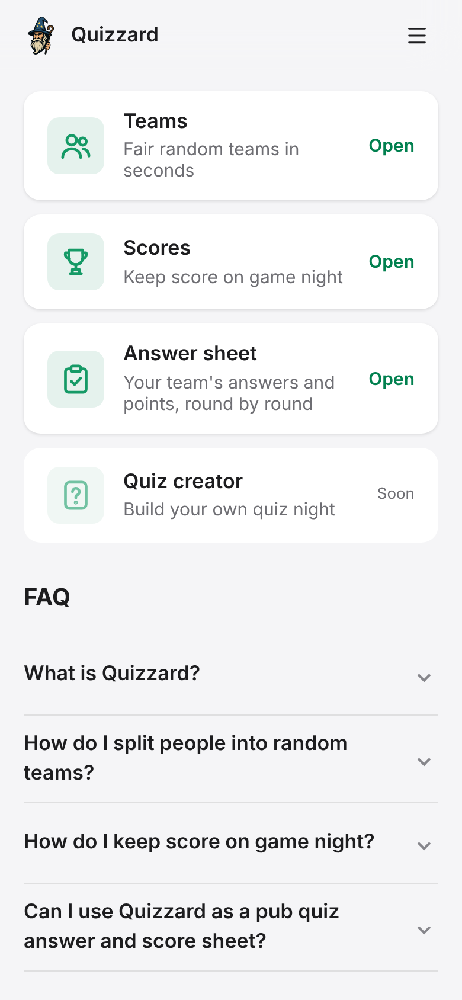

# Quizzard user documentation

Quizzard is a free toolkit for pub quizzes and game nights. It has three tools: **Teams** makes fair random teams, **Scores** keeps score for a game, and **Answer sheet** records your team's answers and points round by round. Quizzard runs in your browser, works offline, needs no account and keeps your data on your device. Open it at [simeontsvetanov.github.io/Quizzard](https://simeontsvetanov.github.io/Quizzard/). A quiz creator is planned; its card on the home screen can't be opened yet.

<picture>
  <source media="(prefers-color-scheme: dark)" srcset="images/home-dark.png">
  
</picture>

## How-to guides

The following guides each cover one task:

- [Make teams](how-to/make-teams.md) — type or paste names, choose how many teams, shuffle again, copy or share the result.
- [Keep score](how-to/keep-score.md) — add players, change scores, read the leaderboard and share it as text.
- [Use the answer sheet](how-to/use-the-answer-sheet.md) — write your team's answers, mark them and count the points round by round.
- [Install the app](how-to/install-the-app.md) — open Quizzard like an app, with shortcuts to the tools and without internet.
- [Back up and move your data](how-to/back-up-and-move-your-data.md) — save everything to one file, load it on another device or delete it.
- [Change the language and theme](how-to/change-language-and-theme.md) — switch between English and Български, and between light and dark.

## Reference

- [Settings](reference/settings.md) — the menu and every option in **Settings**.
- [Limits](reference/limits.md) — how many names, players, rounds and answers each tool takes.

## About

- [Privacy and data](about/privacy-and-data.md) — what Quizzard saves, where, and what never leaves your device.
